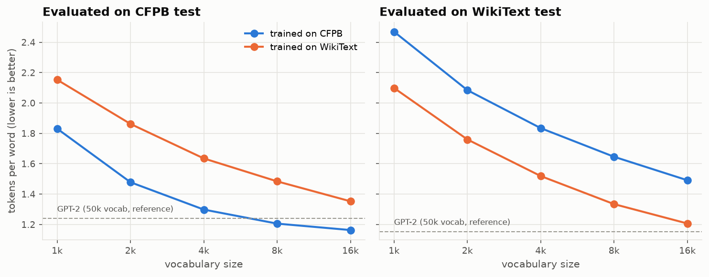

# bpe/: A Byte-Pair-Encoding Tokenizer, Trained on Consumer-Finance Text

A from-scratch byte-level BPE tokenizer (train, encode, decode, save/load) that keeps CFPB redaction tokens whole. It is compared against a tokenizer trained on general text **at the same vocabulary size**. At 8k tokens, the complaint-trained tokenizer needs 19% fewer tokens per word on complaints than the general one, and also beats GPT-2's 50k vocabulary on this text. Finance terms like `forbearance` and `FDCPA` become single tokens.

**Stack:** Python · `regex` · pytest · hypothesis · (cross-check only) `tiktoken`

---

## 1. What a tokenizer is for

A model can't read strings, only integers. A tokenizer decides how to cut text into pieces and which integer each piece gets. Cut at words and you get an enormous vocabulary, plus an `<unk>` for every rare word. Cut at characters and sequences get long. BPE sits between: start from single bytes and repeatedly **merge the most frequent adjacent pair into a new symbol**. Common strings (`ing`, ` payment`) become one token, and rare strings break into smaller known pieces. Nothing is ever unknown, because every string is made of bytes.

A tokenizer only learns the strings it saw often. In 150,000 loan and credit complaints, `forbearance` appears thousands of times, so BPE merges it all the way to one token. A tokenizer trained on Wikipedia rarely sees it. It finds `for` and `bear`, which are common English pieces, and spells the rest out: `for b ear ance`, four tokens. That matters downstream for three reasons. Every extra token makes the sequence longer, and a model with a fixed context budget then sees less of the complaint. The embedding layer has to learn a meaning for `forbearance` from four generic pieces instead of one dedicated vector. And `bear` now carries noise from an unrelated word.

---

## 2. What this shows

1. A correct implementation of training, encoding and decoding, with round-trip tests, including property tests on arbitrary unicode.
2. Training fast enough for a real corpus: incremental pair-count updates instead of a full rescan per merge, **200-260x faster** with an identical merge list.
3. A measured claim, not an assumption: domain training changes how finance terms are tokenized, with vocabulary size held fixed.

---

## 3. Algorithm, step by step

### 3.1 Pre-tokenization

BPE never merges across the boundaries a pre-tokenizer draws, so `"payment due"` can't produce a token that spans the space and half of the next word. The pre-tokenizer is the GPT-2 regex, using the `regex` module (not `re`) for `\p{L}`:

```python
PRETOK = regex.compile(
    r"""'s|'t|'re|'ve|'m|'ll|'d| ?\p{L}+| ?\p{N}+| ?[^\s\p{L}\p{N}]+|\s+(?!\S)|\s+"""
)
# "I paid $50 on 3/4." -> ["I", " paid", " $", "50", " on", " ", "3", "/", "4", "."]
```

Special tokens are split out **before** this regex runs, so they're never broken apart (`bpe/pretokenize.py: split_specials`).

One consequence of this pattern: `charge-off` is always three pieces (`▁charge - off`), in every tokenizer including GPT-2. The regex puts the hyphen in its own pre-token, so no merge can ever cross it.

### 3.2 Base alphabet: bytes, not characters

Each of the 256 byte values maps to a printable unicode character (GPT-2's `bytes_to_unicode`), so merges can be stored as readable strings. Consequences:
- There is never an `<unk>`.
- An emoji costs up to 4 base tokens until it's merged.
- Vocabulary size = 256 + merges + special tokens.

### 3.3 Training: the reference implementation

`bpe/train.py: train_naive` counts each pre-token once with its frequency, then repeatedly takes the most frequent pair and rewrites every word. It is correct and slow, because every merge rescans the whole table. It is the **reference**: the fast trainer must produce the identical merge list.

**Determinism:** ties break on `(count, pair)`, so the lexicographically larger pair wins and dict order never decides. On the classic toy corpus (`low` ×5, `lower` ×2, `newest` ×6, `widest` ×3), `(e, s)` and `(s, t)` tie at 9, so the first merges are `(s, t)` then `(e, st)` (`test_toy_corpus_first_merges`).

### 3.4 The fast trainer

`train_incremental` keeps the pair counts plus an index from each pair to the words containing it. After choosing the best pair, it touches only those words: it subtracts their old pair contributions, rewrites them, and adds the new ones. The best pair comes from a heap with lazy invalidation (entries whose count changed are skipped when popped). Each merge then costs time proportional to the affected words, not the whole table.

| Version | Per-merge cost | Use |
|---|---|---|
| Naive rescan | O(unique words × word length) | Reference for tests |
| Incremental + inverted index + heap | O(words containing the pair) | Real training |

Equivalence is tested on the fixture corpus (300 merges) and with hypothesis on random small corpora.

### 3.5 Special tokens and redaction handling

Special tokens are registered before training, never merged, and get fixed ids at the start of the vocabulary (`config.SPECIALS`):

| Token | Purpose |
|---|---|
| `<pad>` `<bos>` `<eos>` `<unk>` | Sequence plumbing. `<unk>` exists for API compatibility and is never emitted; a test checks this on the whole test split |
| `<REDACTED>` | Replaces `XXXX` runs (`corpus/normalize.py` does the replacing; the tokenizer only keeps the token atomic) |
| `<DATE>` | Replaces `XX/XX/XXXX` and partial dates |
| `<AMT>` | Replaces `{$1,234.56}`, including masked `{$XXXX}` amounts |

**`<AMT>` decision: one token for every amount, not magnitude buckets.** The CFPB already masks most amounts inside the braces (`{$XXXX}` shows up as often as real numbers), so a bucket would often have nothing to bucket. The downstream tasks (Product and Issue classification) don't depend on how large the disputed amount was. Buckets would also add three special tokens for a hint the labels don't use. If a task needed amount size, such as predicting monetary relief, bucketing would be the first thing to revisit.

### 3.6 Encoding

`_encode_piece` repeatedly applies the **lowest-rank** (earliest-learned) merge available to one pre-token, with a per-pre-token cache. Encoding has to replay merges in the order they were learned. Greedy longest-match would tokenize some strings differently than training did. A test checks that cold-cache and warm-cache encodings are identical.

### 3.7 Decoding

Token strings are concatenated, mapped back to bytes, and decoded with `errors="replace"`. Decoding a slice that cuts a multi-byte character in half is legitimate during generation, which is why it isn't `strict`.

### 3.8 Save / load format

```
bpe/artifacts/<name>/
├── vocab.json      # token string -> id
├── merges.txt      # one "a b" per line, in rank order
└── config.json     # specials, pattern version, corpus name + hash, n_merges, training time
```

`config.json` stores a hash of the complaint IDs the tokenizer was trained on. `tests/test_no_leakage.py` checks that it equals the train split's hash.

---

## 4. Directory layout

```
bpe/
├── README.md
├── pretokenize.py        # regex, byte<->unicode tables, special-token splitting, word counts
├── train.py              # train_naive (reference) + train_incremental
├── tokenizer.py          # Tokenizer: train / encode / decode / save / load / truncated
├── evaluate.py           # fertility, bytes/token, term fertility, <unk> rate, redaction integrity
├── scripts/
│   ├── train_bpe.py      # --corpus cfpb|general --vocab-size 16000 --out ...
│   ├── compare_general.py# 2x2 at V=8k, sweep 1k-16k, GPT-2 reference, per-term table, figure
│   ├── eval_tokenizer.py # metrics for one tokenizer on one split
│   └── bench.py          # naive vs incremental timing, encode throughput
├── artifacts/            # cfpb_16k, general_16k, and their 8k truncations (committed, ~1 MB)
├── notebooks/inspect_merges.ipynb
└── tests/test_bpe.py
```

The sweep trains each corpus once at 16k and truncates. Greedy BPE is a prefix process: the first k merges of a 16k run are exactly what a k-merge run would learn (`test_truncated_equals_retrained`).

---

## 5. Evaluation

All metrics are computed on the **test** split (Jul-Dec 2022, 20,000 complaints). The tokenizers saw **train** only (2018-2021, 150,000 complaints). The general-text tokenizer was trained on a WikiText-103 sample matched to the CFPB train split in UTF-8 bytes (165 MB each).

| Metric | Definition | Reading it |
|---|---|---|
| Fertility | tokens ÷ whitespace-separated words | Lower is better |
| Compression | UTF-8 bytes ÷ tokens | Higher is better |
| Finance-term fertility | tokens per term over `eval/probe_terms.txt` (50 terms, encoded mid-sentence with a leading space) | Where domain training should show |
| `<unk>` rate | emitted `<unk>` ÷ tokens | Must be 0 |
| Redaction integrity | `<REDACTED>`, `<DATE>`, `<AMT>` each encode to exactly 1 token | Must be 100% |

### 5.1 The controlled comparison (V = 8k for both)

| Trained on | Fertility, CFPB test | Fertility, WikiText test | Bytes/token, CFPB test | Bytes/token, WikiText test | Finance-term fertility |
|---|---:|---:|---:|---:|---:|
| CFPB train | **1.206** | 1.646 | **4.74** | 3.25 | **1.16** |
| WikiText sample (size-matched) | 1.484 | **1.334** | 3.85 | **4.00** | 2.74 |
| GPT-2 (V=50,257; not controlled) | 1.240 | 1.153 | 4.61 | 4.63 | 1.58 |

The GPT-2 row is context only. It has a 6x larger vocabulary trained on different data, so it is not part of the controlled comparison. The CFPB-trained 8k tokenizer has `<unk>` rate 0.0000 and redaction integrity 1.0000 on the test split.

### 5.2 Vocabulary-size sweep



| Trained on | V=1k | V=2k | V=4k | V=8k | V=16k |
|---|---:|---:|---:|---:|---:|
| CFPB-trained (CFPB test / WikiText test) | 1.831 / 2.469 | 1.478 / 2.084 | 1.298 / 1.834 | 1.206 / 1.646 | 1.163 / 1.491 |
| WikiText-trained (CFPB test / WikiText test) | 2.153 / 2.099 | 1.862 / 1.760 | 1.635 / 1.519 | 1.484 / 1.334 | 1.353 / 1.207 |

### 5.3 Per-term table (V = 8k)

| Term | CFPB-trained | WikiText-trained | GPT-2 |
|---|---|---|---|
| `forbearance` | ▁forbearance | ▁for b ear ance | ▁forb earance |
| `garnishment` | ▁garnishment | ▁g arn ish ment | ▁garn ishment |
| `reinvestigation` | ▁reinvestigation | ▁rein vest ig ation | ▁reinvest igation |
| `delinquent` | ▁delinquent | ▁del in qu ent | ▁delinquent |
| `escrow` | ▁escrow | ▁esc row | ▁esc row |
| `Equifax` | ▁Equifax | ▁E qu if ax | ▁Equ ifax |
| `FDCPA` | ▁FDCPA | ▁F D C PA | ▁F DC PA |
| `furnisher` | ▁furnisher | ▁f urn isher | ▁furn isher |
| `charge-off` | ▁charge - off | ▁charge - off | ▁charge - off |
| `amortization` | ▁am ort ization | ▁am ort ization | ▁am ort ization |
| `levy` | ▁le v y | ▁le v y | ▁levy |

The full 50-term table is in [`reports/summary.md`](../reports/summary.md).

**What the 2×2 shows.** The diagonal wins at every vocabulary size. On complaint text, the CFPB-trained tokenizer needs 1.206 tokens per word against 1.484 for the WikiText-trained one, 19% fewer tokens for the same text. It holds finance terms almost whole (1.16 tokens per term against 2.74). The cost shows up off-diagonal: on Wikipedia it needs 1.646 tokens per word against 1.334, so the tokenizer bought its compression on complaints by not learning general English. The effect isn't a vocabulary-size artifact, since both sides of the comparison have 8,000 tokens and saw the same number of bytes. The curves also show where extra vocabulary stops paying on complaints: going from 8k to 16k removes only 0.04 tokens per word, against 0.18 from 2k to 4k. Even at 8k, the domain tokenizer beats GPT-2's 50k vocabulary on this text (1.206 vs 1.240). But it loses `levy` and `amortization`: they are too rare in complaints to earn a merge, while a general vocabulary of 50k tokens has room for them.

**Merges that are artifacts of the data.** `inspect_merges.ipynb` shows a few tokens that only make sense once you know how complaints get written:
- `▁1681` is a single token. Credit-report dispute letters cite the Fair Credit Reporting Act as "15 U.S.C. 1681" or "15 USC 1681", in 3,266 of the 150,000 training complaints, so the section number earned its own vocabulary slot.
- A run of 32 underscores and a run of 16 asterisks are both single tokens. They come from form lines and separators pasted into complaints.
- Company names (`▁Navient`, `▁Ocwen`, `▁Comenity`, `▁Synchrony`) are whole tokens too.

The tokenizer is learning the genre (template letters, pasted forms) as much as the vocabulary of lending.

---

## 6. Tests

`pytest bpe/tests` runs 25 tests in about 3 seconds on the synthetic fixture corpus:

| Test | What it catches |
|---|---|
| `decode(encode(s)) == s` on ASCII, accents, emoji, CJK, tabs, `\r\n`, empty string, specials | Byte-mapping bugs, lossy decode |
| Same property under **hypothesis** with arbitrary unicode (300 examples) | Edge cases nobody thought of |
| Naive == incremental on the fixture (300 merges) and on random small corpora (hypothesis) | Index-update bugs in the fast trainer |
| Training twice gives byte-identical `merges.txt` | Non-determinism from tie-breaking |
| Special tokens encode to exactly one id, in and out of context | Specials split by the pre-tokenizer |
| `<unk>` never appears in the test-split output | Byte coverage gaps |
| `vocab size == 256 + n_merges + n_specials` | Off-by-one in merge counting |
| Encoding is the same with a cold and a warm cache | Cache poisoning |
| Truncating a 700-token run to 450 equals training to 450 | The sweep's shortcut |
| Save → load reproduces merges, vocab and encodings | Serialization |
| Tokenizer fit hash == train-split hash (`tests/test_no_leakage.py`) | Leakage |

---

## 7. Performance

Time to reach V = 8,000 (7,737 merges). Pure Python on an Apple Silicon laptop (arm64, macOS, Python 3.12), with no other CPU-heavy work running:

| Complaints | Unique pre-tokens | Naive (s) | Incremental (s) | Speedup |
|---:|---:|---:|---:|---:|
| 1,000 | 9,775 | 124 | 0.62 | 200x |
| 10,000 | 28,655 | 524 (projected) | 1.99 | 263x |
| 100,000 | 85,531 | 1,894 (projected) | 9.09 | 208x |

The naive trainer had a 300-second budget per size. Where it ran out, its total is projected from its per-merge time so far, and the merge lists it did produce were checked to match the incremental trainer's. Early merges are the naive trainer's slowest (words are longest then), so the projections lean high. Full training on 150,000 complaints (165 MB) to 16k takes 25 seconds. Encoding runs at about 3,500 complaints/s with the pre-token cache, with 733 MB peak memory for the benchmark process.

---

## 8. Limitations

- Trained on English complaint text from one US regulator's database. Other financial registers (earnings calls, contracts) will tokenize worse; the WikiText column already shows the domain cost.
- Byte-level BPE can split a single non-Latin character into several tokens. That's irrelevant here but true.
- The vocabulary is frozen at the 2021 train cutoff, so products and scams that appear later get no dedicated tokens.
- Merge order is driven by frequency, not linguistics. `▁le v y` doesn't mean anything about the word `levy`.
- Hyphenated terms (`charge-off`) can never become one token under this pre-tokenizer.
- Special tokens are split out before pre-tokenization, so the space in front of a redaction token stays behind as its own `▁` token (`▁charged ▁ <AMT>`). Every redaction costs two tokens instead of one.
- Pure Python: this explains the algorithm, it doesn't replace a production tokenizer.

---

## 9. Reproduce

From the repository root, after `make data`:

```bash
python -m bpe.scripts.train_bpe --corpus cfpb --vocab-size 16000 --out bpe/artifacts/cfpb_16k
python -m bpe.scripts.train_bpe --corpus general --vocab-size 16000 --out bpe/artifacts/general_16k
python -m bpe.scripts.compare_general        # writes the 8k truncations, the sweep and the figure
python -m bpe.scripts.eval_tokenizer --tokenizer bpe/artifacts/cfpb_8k --split test
python -m bpe.scripts.bench
pytest bpe/tests
```

`make tokenizer` runs all of these.
