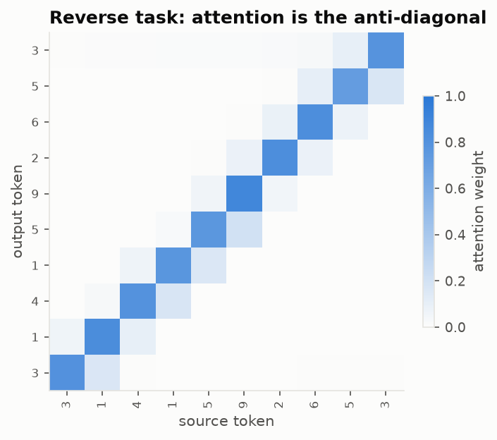
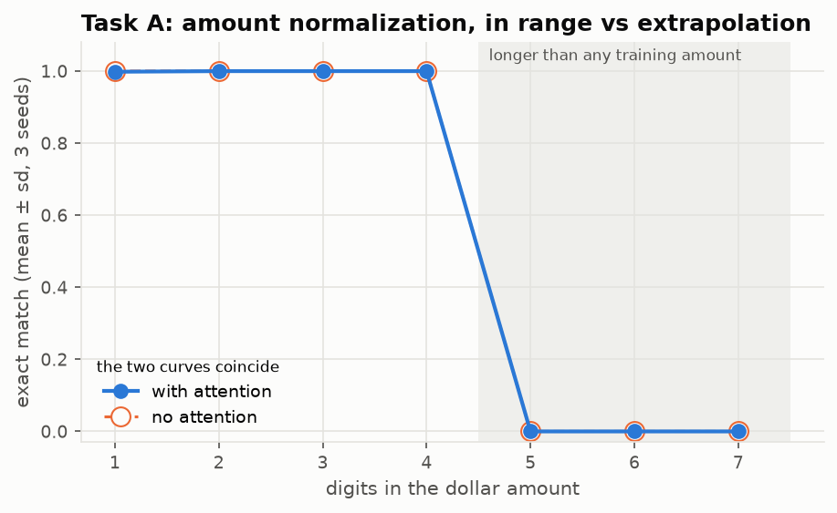
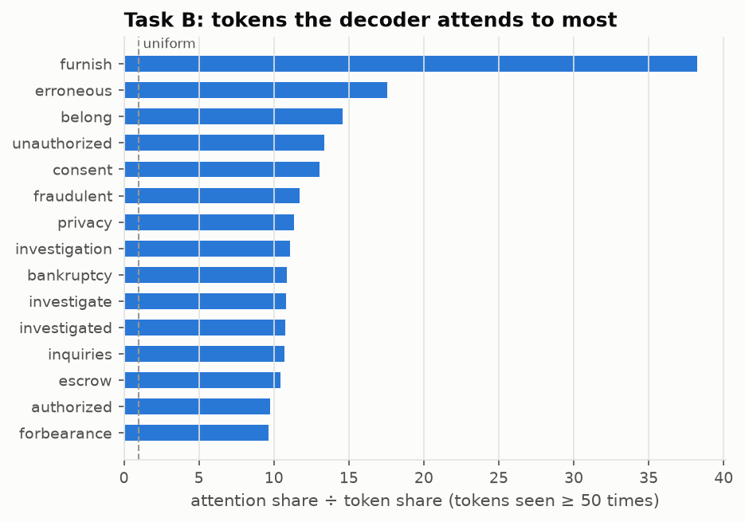

# seq2seq/: An Attention-Based Encoder–Decoder, Built Up From Toy Tasks to CFPB Complaints

A PyTorch GRU encoder–decoder with additive attention, written from `nn.GRU`, `nn.GRUCell` and `nn.Linear` (no `nn.Transformer`, no seq2seq library). It is verified on toy tasks first, then applied to two problems:
1. Converting spelled-out money amounts to digits, where length extrapolation can be tested.
2. Mapping complaint narratives to a `Product | Issue` label string, compared against TF-IDF + logistic regression.

**Result:** the model learns amount normalization perfectly up to 4 digits and gets **0%** on longer numbers: it learned the output template, not place value. On complaints, it reaches **0.513 ± 0.039** exact-match accuracy over 56 labels, against **0.483** for TF-IDF + LR. Macro-F1 is tied (0.363 vs 0.365). That beat my own prediction: I expected it to lose.

**Stack:** Python · PyTorch · `num2words` (synthetic data) · scikit-learn (baseline only) · pytest · matplotlib

---

## 1. What a sequence-to-sequence model is

A variable-length input goes in and a variable-length output comes out. The **encoder** reads the input and produces a state for each position. The **decoder** writes the output one token at a time. Each step is conditioned on what it has already written and, through **attention**, on a weighted look at the encoder states. Without attention, the whole input must squeeze through one fixed vector, and long inputs suffer for it.

**Teacher forcing and exposure bias.** During training, the decoder is fed the *true* previous token at each step. If it predicts `$1,2` but the answer is `$1,3`, it is still handed `3` and asked for the next character. That makes training fast and stable, because every step learns from a correct prefix. At inference there is no answer to hand over, so the decoder is fed its *own* previous prediction. The mismatch is called exposure bias: the model never practiced recovering from its own mistakes, so one wrong token can derail everything after it. Scheduled sampling, an ablation here, feeds the model its own predictions for a growing fraction of training steps to close that gap.

---

## 2. Why two tasks

| | Task A: amount normalization (synthetic) | Task B: narrative → label string (real) |
|---|---|---|
| Example | `two hundred fifty dollars and thirty cents` → `$250.30` | complaint text → `Debt collection \| Attempts to collect debt not owed` |
| Data | Generated by code, perfectly clean | CFPB narratives with their `Product`/`Issue` |
| What it teaches | Whether the model learned an algorithm; **length extrapolation** is testable | Behavior on messy long text; an honest comparison with a simple baseline |
| Expected outcome (written before the runs) | Works in-distribution, degrades on longer numbers than it saw | Trails TF-IDF + LR; interesting mainly for what attention looks at |
| What happened | Exactly that, and more sharply than expected: 100% → 0% | Beat TF-IDF on accuracy (+3 points), tied on macro-F1 |

Task B is a classification problem wearing a generation costume. It is here because it connects to the rest of the suite, and because comparing against the simple tool is part of the evaluation, whichever way it comes out.

**Build order:** toy copy/reverse (§5.1) → Task A → Task B. Each stage gates the next.

---

## 3. Data

### 3.1 Task A: synthetic amounts (`data_taskA.py`)

**Convention (American, applied everywhere):**
- no "and" inside the dollar part: `one hundred five`
- "and" only before cents
- singular `dollar` / `cent` for 1
- `zero dollars` when dollars are 0
- cents omitted when 0
- target always has two decimals: `$0.05`, `$1,000.00`

- **Tokenization:** source at word level (35-word closed vocabulary); target at character level (`$`, digits, `,`, `.`).
- **Splits:**
  - train, val and test-in use dollar amounts with 1 to 4 digits. The val and test sets have 200 amounts per digit count, and train has the rest: 600 one-digit and 8,600 two-digit amounts, plus 15,000 each of 3 and 4 digits (39,200 in total).
  - test-out (extrapolation) has 300 amounts each with 5, 6 and 7 digits.
  - No (dollars, cents) pair appears in two splits (tested).
- **Built-in wrinkle:** 7-digit amounts need the word `million`, which never occurs in training, so it maps to `<unk>`. 5- and 6-digit amounts use only known words (`sixty thousand eight hundred ...`), so they test extrapolation of *structure*, not vocabulary.

### 3.2 Task B: narratives → labels (`data_taskB.py`)

- **Source:** the first L tokens (L = 128) of the normalized narrative in the CFPB-trained BPE (`bpe/artifacts/cfpb_8k`). When the cut would land inside a word, trailing pieces are dropped back to a word start, so truncation never splits a word.
- **Target:** `"{Product} | {Issue}"` in the same BPE, re-indexed into a 191-token target vocabulary containing only the tokens that occur in labels. The longest label is 26 tokens.
- **Label window:** 2018–2022 (stable Product names; root README §2.1). Labels with fewer than 200 training examples collapse to `Other | Other`, which keeps 55 labels plus `Other` and covers 97.8% of train rows. This is fit on train only.

---

## 4. Model (`model.py`)

- **Encoder:** embedding → bidirectional GRU over packed sequences (padding never enters the recurrence) → the forward and backward final states go through a `tanh(Linear)` bridge to the decoder's initial state.
- **Attention (additive / Bahdanau):** `score = vᵀ tanh(W_h h_j + W_s s)`. Pad positions are filled with `-inf` before the softmax, so they get exactly zero weight. `W_h h_j` is computed once per sequence, not once per step.
- **Decoder step:** `GRUCell([embed(prev), context])`, then `Linear([state, context, embed(prev)])` → logits. It attends using the previous state.
- **No-attention variant** (ablation): the context is the encoder's concatenated final states, the same vector at every step (Cho et al. 2014).
- **Training (`train.py`):**
  - targets shifted by one (`[<bos>, y…]` → `[y…, <eos>]`)
  - `cross_entropy(ignore_index=PAD)`
  - Adam 1e-3, gradient clipping at 1.0, batch 64, dropout 0.2
  - teacher forcing 1.0, with scheduled sampling as an ablation
  - keeps the weights with the best validation exact match

### 4.5 Decoding (`decode.py`)

- **Greedy:** argmax until `<eos>`.
- **Beam search** (width 5): keeps the 5 best unfinished hypotheses per step and moves those that emit `<eos>` to a finished list. It stops only when no unfinished hypothesis can still win. Ranking uses summed log-probability, optionally divided by length (`alpha`).

  Without length normalization, beam search prefers short outputs. Every extra token multiplies in a probability below 1, which adds a negative log-prob, so a hypothesis that stops early always has the higher raw score. Dividing by length compares hypotheses by their average per-token confidence instead.

  For Task B, labels are ranked by **total** log-probability (`alpha = 0`): picking a label means wanting the most probable label, not the one with the highest average per-token confidence. This was chosen on held-out validation complaints: 0.453 accuracy vs 0.430 with length normalization.

- **Trie-constrained beam** (Task B): a trie over the 56 valid label token sequences masks every token that would leave the set of real labels, so the model can't emit a label that doesn't exist.

**A bug worth recording.** The first beam search stopped as soon as 5 hypotheses had finished. On seed 1's test set it scored **0.281** accuracy against **0.479** for greedy decoding: unlikely labels that happened to end early filled the 5 slots, and the most likely label, still being extended, never got a chance. The existing test (beam width 1 = greedy) couldn't catch it, because with width 1 there is nothing to crowd out. The fix keeps searching until no live hypothesis can win. A new test uses a stub model whose most probable label is known exactly; it fails on the old decoder and passes on the fixed one. All reported numbers come from the fixed decoder, re-run on the saved models.

---

## 5. Correctness first

### 5.1 Toy gates (`scripts/run_toy.py`)

| Gate | Pass criterion | Result |
|---|---|---:|
| Copy a random digit string (length 3-12) | 100% test exact match | **1.000** |
| Reverse a random digit string | ≥ 99% exact match; attention is the anti-diagonal | **0.999**; 80% of attention weight on the anti-diagonal |
| Overfit 32 Task A examples | train loss → ~0, 100% exact match | **1.000**, loss 0.0002 |

All three passed before any real data was touched. The reverse task is the classic attention check: if masking, the target shift or the attention itself were wrong, the heatmap below would not be an anti-diagonal.



### 5.2 Unit tests (`pytest seq2seq/tests`, 10 tests, ~4 s)

| Test | What it catches |
|---|---|
| Logits at step t are unchanged when `tgt_in[:, t+1:]` changes | The decoder peeking at future target tokens (shift bug) |
| A sequence's output is identical (1e-5) alone or padded next to a longer one, with and without attention | Padding leaking through the encoder or the attention mask |
| Attention is exactly 0 on pad positions and sums to 1 | Mask bug |
| Changing logits at pad-target positions doesn't change the loss | Missing `ignore_index` |
| Beam search with width 1 equals greedy | Beam implementation bugs |
| On a stub model with known probabilities, beam (width 2, trie) returns exactly the most probable of 8 nested labels | Beam stopping before the best hypothesis finishes (the bug above) |
| Trie-constrained beam only outputs valid sequences | Constraint bugs |
| Task A generator round trip: words → number and `$1,234.05` → number recover the original | Bad synthetic labels |
| No source string shared between Task A splits | Leakage |
| Same seed → identical outputs | Hidden nondeterminism |

`tests/test_end_to_end_smoke.py` also trains a tiny Task B model on the synthetic fixture and checks that constrained decoding only produces real labels.

---

## 6. Experiments

### 6.1 Task A

| Metric | With attention | No attention |
|---|---:|---:|
| Exact match, 1-4 digits (test-in, 800) | **1.000 ± 0.001** | 1.000 ± 0.000 |
| Exact match, 5-7 digits (test-out, 900) | **0.000 ± 0.000** | 0.000 ± 0.000 |
| Character accuracy, 1-4 digits | 1.000 | 1.000 |

3 seeds each, 12 epochs, ~23 minutes per run on CPU.

| Digits | 1 | 2 | 3 | 4 | 5 | 6 | 7 |
|---|---:|---:|---:|---:|---:|---:|---:|
| With attention | 1.00 | 1.00 | 1.00 | 1.00 | 0.00 | 0.00 | 0.00 |
| No attention | 1.00 | 1.00 | 1.00 | 1.00 | 0.00 | 0.00 | 0.00 |



| Metric | With attention | No attention |
|---|---:|---:|
| Exact match, 1-4 digits (test-in, 800) | **1.000 ± 0.001** | 1.000 ± 0.000 |
| Exact match, 5-7 digits (test-out, 900) | **0.000 ± 0.000** | 0.000 ± 0.000 |
| Character accuracy, 1-4 digits | 1.000 | 1.000 |

3 seeds each, 12 epochs, ~23 minutes per run on CPU.

| Digits | 1 | 2 | 3 | 4 | 5 | 6 | 7 |
|---|---:|---:|---:|---:|---:|---:|---:|
| With attention | 1.00 | 1.00 | 1.00 | 1.00 | 0.00 | 0.00 | 0.00 |
| No attention | 1.00 | 1.00 | 1.00 | 1.00 | 0.00 | 0.00 | 0.00 |_FAILURES

### 6.2 Task B

| System | Exact-match accuracy | Macro-F1 | Invalid-label rate |
|---|---:|---:|---:|
| Majority label | 0.188 | 0.006 | - |
| TF-IDF + LR (predicts label id) | 0.483 | **0.365** | - |
| Seq2seq, greedy | 0.509 ± 0.038 | 0.360 ± 0.014 | 0.000 |
| Seq2seq, beam 5 | **0.513 ± 0.039** | 0.363 ± 0.014 | 0.000 |
| Seq2seq, beam 5 + trie | **0.513 ± 0.039** | 0.363 ± 0.014 | 0.000 |

Test split: 20,000 complaints from Jul-Dec 2022, 56 labels. Final config: word2vec-initialized embeddings, L = 256, 4 epochs, 3 seeds. Per seed, beam 5 accuracy was 0.500 / 0.483 / 0.557.

- **Head vs tail** (seed 0): accuracy 0.522 on the 10 most frequent labels, 0.442 on the rest.
- **The trie never mattered:** unconstrained beam search never produced an invalid label (rate below 0.0001), so constraining it changed nothing.

**Why 51% is a reasonable number here.** Exact match over 56 Product | Issue labels is a hard target. On Product alone, TF-IDF gets 84% (see `word2vec/README.md` §6.3). Nearly all the errors stay inside one product and swap a neighboring credit-reporting issue:

| Count (seed 0) | True issue → predicted issue |
|---:|---|
| 1,524 | Improper use of your report → Problem with a credit reporting company's investigation |
| 906 | Problem with … investigation → Incorrect information on your report |
| 749 | Incorrect information → Problem with … investigation |
| 491 | Improper use → Incorrect information |

The labels are picked from a menu by consumers, and one complaint often fits all three. The time split adds drift on top: "Improper use of your report" is **4.1%** of training complaints but **17.5%** of test complaints (it surged in 2022). A model trained on 2018-2021 has rarely seen it, and it is the single largest source of errors for both seq2seq and TF-IDF.

**The verdict, and why I got it wrong in advance.** I expected seq2seq to trail TF-IDF; instead it leads on accuracy by 3 points and ties on macro-F1. The likely reasons: word2vec-initialized embeddings (the largest ablation effect, +4 points) and a 256-token window let the GRU use word order and context that a bag of n-grams can't. But the gain is concentrated in frequent labels: macro-F1, which weights all 56 labels equally, doesn't move. The seed spread (0.48-0.56) is also as large as the gap to TF-IDF, so "better" here means "better on average over three seeds", not "reliably better". A classification head on the same encoder would be the cleaner design: same signal, no decoding, no invalid outputs to guard against.

### 6.3 Ablations (Task B)

Each ablation changes one knob at a time from the base config: CFPB BPE, L=128, attention, random embedding init, teacher forcing 1.0, hidden 256, embedding 300 (to match the chosen word2vec dimension). Each config trains on the first 50,000 train complaints for 2 epochs and is scored by **val** exact match (greedy, 4,000 val complaints). The base config runs 3 seeds, and each knob runs 1 seed. A change is adopted only if it beats the base mean by more than one base standard deviation.

**Reduced compute budget.** Everything here trains on a laptop CPU, so Task B runs on a trimmed schedule. Ablations get 2 epochs, with 1 seed per knob (the base config keeps 3 seeds for its standard deviation). Final models get 4 epochs with 3 seeds. The planned hidden-size ablation (128 / 512) was dropped. With one seed per knob, an ablation can only flag a large effect; small differences are within seed noise. The Task B models are therefore likely under-trained relative to what a GPU budget would allow. The comparison with TF-IDF should be read with that in mind: the gap is an upper bound on how far seq2seq trails, not a settled verdict.

| Change from base | Val exact match | Seeds | Adopted |
|---|---:|---:|---|
| **Embeddings initialized from word2vec** (BPE-unit vectors, 99.2% of the vocabulary covered) | **0.477** | 1 | **yes** |
| **L = 256** | **0.448** | 1 | **yes** |
| No attention | 0.440 | 1 | no (within noise of base) |
| *Base* | *0.436 ± 0.006* | *3* | |
| Scheduled sampling (teacher forcing 1.0 → 0.5) | 0.432 | 1 | no |
| L = 64 | 0.417 | 1 | no |
| WikiText-trained BPE instead of CFPB-trained (same 8k size) | 0.378 | 1 | no |

The two links between components both pay off, which is the point of building them as a suite.
- **word2vec → seq2seq:** starting the encoder from word2vec vectors is the largest single gain (+4 points). After 2 epochs on 50k complaints, randomly initialized embeddings haven't caught up with vectors learned from 150k.
- **BPE → seq2seq:** swapping the domain tokenizer for the general one costs about 6 points at the same vocabulary size. The general tokenizer spends more tokens per complaint, so 128 tokens cover less text, and its pieces (`for b ear ance`) carry less meaning each.
- **Attention:** removing it is the surprise. At 2 epochs and 128 tokens, the model without attention is no worse (0.440 vs 0.436 ± 0.006). For a short classification-like output, the encoder's final state carries most of what's needed.
- **Hidden size:** a 128/512 ablation was planned and dropped to save compute.

### 6.4 Looking inside

Attention heatmaps over complaint text would publish the text, so the attention analysis works at the token level instead. Across 2,000 test complaints, each source token's share of attention is divided by its share of tokens ("lift"). A lift of 1.0 means the decoder looks at the token exactly as often as it appears.

| Token group | Share of attention | Share of tokens | Lift |
|---|---:|---:|---:|
| `<REDACTED>` | 0.64% | 3.05% | 0.21 |
| `<DATE>` | 0.14% | 0.83% | 0.17 |
| `<AMT>` | 0.14% | 0.47% | 0.29 |
| Punctuation | 0.45% | 13.4% | 0.03 |

The tokens with the highest lift are `furnish` (38×), `erroneous`, `belong`, `unauthorized`, `consent`, `fraudulent`, `privacy`, `investigation`, `bankruptcy`, `inquiries`, `escrow` and `forbearance`. The lowest, near zero, are filler words: `very`, `so`, `I`, `could`, `spoke`, `After`.

The attention looks like evidence, not noise. The top tokens line up with how the label menu is worded:
- `furnish` and `erroneous` point to an inaccurate report from a data furnisher (Incorrect information).
- `consent`, `privacy` and `unauthorized` point to a pull without permission (Improper use).
- `investigation` points to the bureau's handling (Problem with … investigation).

Redaction tokens are almost ignored (a fifth of their frequency), and punctuation even more so. In the misclassified examples, the attended tokens are often *right but ambiguous*. One complaint labelled "Incorrect information" got attention on `FRAUD`, `knowingly` and `1681`, vocabulary that fits identity-theft or improper-use issues just as well. The model is looking at the right words; the words don't settle the label.



---

## 7. Directory layout

```
seq2seq/
├── README.md
├── vocab.py            # SymbolVocab with fixed <pad> <bos> <eos> <unk>
├── model.py            # Encoder, Attention, Decoder, Seq2Seq (forward, greedy)
├── decode.py           # beam search with length normalization, Trie
├── train.py            # padding, loss, clipping, scheduled sampling, best-on-val
├── metrics.py          # exact match, character accuracy, per-bucket
├── data_taskA.py       # generator, splits, inverse parsers for tests
├── data_taskB.py       # BPE encoding (cached), word-safe truncation, label vocab
├── common.py           # run saving, attention heatmap
├── scripts/
│   ├── run_toy.py
│   ├── run_taskA.py
│   ├── taskA_failures.py
│   ├── run_taskB.py    # --ablate for the val grid; no flag for the final 3-seed run
│   └── plot_attention.py
├── runs/               # gitignored: checkpoints, histories
└── tests/test_seq2seq.py
```

---

## 8. Results

| Item | Value |
|---|---|
| Toy gates | copy 1.000, reverse 0.999, overfit-32 1.000 |
| Task A exact match, 1-4 digits / 5-7 digits | 1.000 ± 0.001 / 0.000 ± 0.000 |
| Task B accuracy: majority / TF-IDF / seq2seq | 0.188 / 0.483 / **0.513 ± 0.039** |
| Task B macro-F1: TF-IDF / seq2seq | **0.365** / 0.363 ± 0.014 |
| Final Task B config (chosen on val) | CFPB BPE 8k, L = 256, word2vec-initialized embeddings (300-d), BiGRU 256, additive attention, teacher forcing 1.0, beam 5 by total log-prob |
| Parameters | Task A 1.6M; Task B 4.7M (2.4M of it the source embedding) |
| Training time | Task A ~23 min per run on CPU; Task B 2.5-3.7 h per seed for 4 epochs, three seeds sharing one Apple Silicon GPU (MPS); the upper end includes a pause while the laptop slept |

The seq2seq model does exactly what the mechanism allows and no more. It solves amount normalization perfectly inside its training range and fails completely outside it, because what it learned was a template. On complaints, it edges past TF-IDF on accuracy thanks to the other two components (domain BPE and word2vec initialization), and it ties on macro-F1. Most of its remaining errors are label ambiguity and 2022 drift, not misunderstanding. Next steps: swap the decoder for a classification head on the same encoder, train Task A with a few longer examples (or a copy mechanism) to test whether extrapolation is learnable at all here, and move to a pretrained encoder if accuracy were the goal.

---

## 9. Limitations

- Recurrent encoders struggle with long inputs, and truncating to L tokens drops evidence from long complaints (the median is 128 words, p90 402).
- Task A is synthetic and tests the mechanism, not real-world messiness. Real amount mentions are redacted anyway.
- Task B labels are consumer-chosen and overlap (`Incorrect information on your report` vs `Problem with a credit reporting company's investigation into an existing problem`), so accuracy has a ceiling below 100% that no model could cross.
- These are from-scratch models on a modest corpus, so they say nothing about what pretrained transformers achieve.
- Seed variance on small data is real. Differences smaller than the ± sd aren't reported as wins.
- Task B ran on a reduced CPU budget (2-epoch, 1-seed-per-knob ablations; 4-epoch final models; no hidden-size ablation), so its numbers likely understate what the architecture can reach.

Observed while running it:
- **The output template trap (Task A):** the model generalizes the shape of the outputs it saw, not the rule, so any test of extrapolation needs inputs outside the training *output* shapes too.
- **Seed variance is as large as the effect:** Task B test accuracy ranges 0.483-0.557 across three seeds, as wide as the gap to TF-IDF.
- **Label drift dominates the error budget:** one issue's share quadruples between train and test.
- **Beam search was wrong at first** (§4.5). Without a test that knows the right answer, a plausible-looking decoder can quietly cost 20 points.

---

## 10. Reproduce

From the repository root, after `make data`, `make tokenizer`, `make baselines` and `make embeddings` (the word2vec-init ablation needs `word2vec/artifacts/bpe_seed0`):

```bash
python -m seq2seq.scripts.run_toy
python -m seq2seq.scripts.run_taskA
python -m seq2seq.scripts.taskA_failures
python -m seq2seq.scripts.run_taskB --ablate
python -m seq2seq.scripts.run_taskB
python -m seq2seq.scripts.plot_attention
pytest seq2seq/tests
```

`make seq2seq` runs all of these.
