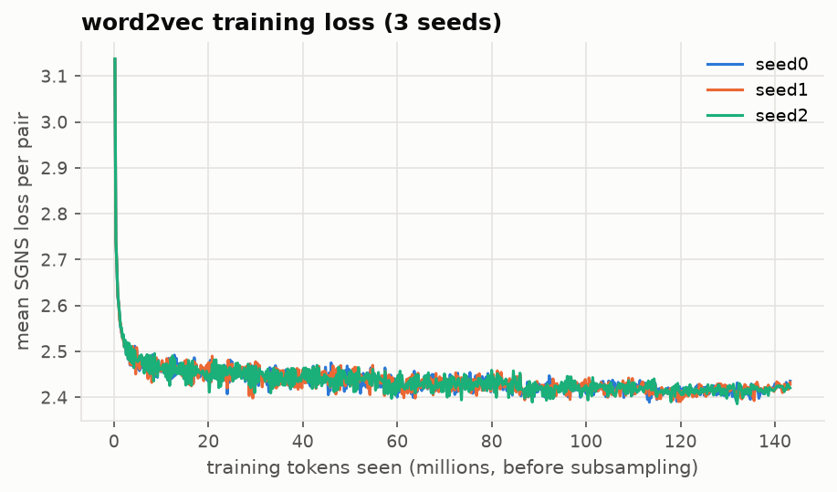

# word2vec/: Skip-Gram with Negative Sampling, From Scratch, on Consumer-Finance Text

A NumPy implementation of skip-gram with negative sampling (SGNS). It is gradient-checked, cross-checked against gensim, and trained on 150,000 CFPB complaint narratives. It is then tested on whether the vectors beat random vectors and a TF-IDF baseline at classifying complaint product. The write-up also looks at where one-vector-per-word fails in finance (`charge`, `balance`, `dispute`).

**Result:** mean-pooled vectors reach **0.736 ± 0.004** test macro-F1 on Product, against 0.607 for random vectors, 0.732 for gensim and 0.757 for TF-IDF + LR. The vectors carry real signal and match the reference implementation, but they don't beat a bag of n-grams on classification.

**Stack:** Python · NumPy · SciPy (sparse sums only) · scikit-learn (evaluation only) · pytest · (cross-check only) gensim

---

## 1. The idea in plain terms

Words that appear in similar contexts have similar meanings. Train a model to predict which words appear near a center word, and the weights it learns become the word's vector. SGNS makes this cheap. Instead of a softmax over the whole vocabulary, it asks a yes/no question: "is this (center, context) pair a real neighbor pair, or a random one?"

Nobody tells the model that `garnish` and `levy` are related. It sees `garnish` next to `wages`, `paycheck`, `judgment` and `bank account`, and sees `levy` next to the same words. Each training step nudges a word's vector toward the vectors of its real neighbors and away from random words. Two words that keep the same company end up pulled toward the same region, so they finish close together without ever appearing side by side. The full softmax version would score every training pair against all ~23,000 vocabulary words, and this corpus produces about 125 million pairs per epoch. Negative sampling replaces those 23,000 scores with 6: the true context word plus 5 random negatives.

---

## 2. The math

Each word has two vectors: **v_w** as a center and **u_w** as a context. For a true pair (center c, context o) and K sampled negatives n_1…n_K:

```
L = - log σ(u_o · v_c)  -  Σ_k log σ(-u_{n_k} · v_c)          σ(x) = 1 / (1 + e^{-x})
```

Gradients (let s_o = σ(u_o·v_c), s_k = σ(u_{n_k}·v_c)):

```
∂L/∂u_o  = (s_o - 1) v_c
∂L/∂u_nk = s_k v_c
∂L/∂v_c  = (s_o - 1) u_o + Σ_k s_k u_nk
```

Read the signs. For a real pair, `s_o - 1` is negative, so the update moves u_o and v_c **toward** each other. For a negative, `s_k` is positive, so they move **apart**.

**Deriving ∂L/∂v_c.** Write x_o = u_o·v_c and x_k = u_{n_k}·v_c. Using d/dx[-log σ(x)] = σ(x) - 1 and d/dx[-log σ(-x)] = σ(x), the loss terms differentiate as ∂L/∂x_o = s_o - 1 and ∂L/∂x_k = s_k. Since ∂x_o/∂v_c = u_o and ∂x_k/∂v_c = u_{n_k}, the chain rule gives ∂L/∂v_c = (s_o - 1) u_o + Σ_k s_k u_{n_k}. `tests/test_w2v.py::test_gradient_check` confirms this numerically (central differences, float64, atol 1e-6), including a batch where ids repeat and a negative equals the center.

---

## 3. Implementation

### 3.1 Vocabulary (`vocab.py`)

Tokens come from a regex that keeps redaction tokens whole and keeps internal hyphens and apostrophes (`charge-off`, `wasn't`). Text is lowercased except for `<REDACTED>`, `<DATE>` and `<AMT>`. Counts come from the **train** split only. Words under `min_count` (5) are **dropped** from the training stream, not mapped to `<unk>`, so a word seen only in test has no vector (tested).

### 3.2 Subsampling frequent words

Words like `the` and `<REDACTED>` appear in nearly every window and teach little. Each occurrence is kept with probability given by the **reference C implementation's** formula, with threshold t = 1e-4:

```
P(keep w) = min(1, sqrt(t / f(w)) + t / f(w))        f(w) = count(w) / total tokens
```

I used the reference-C formula rather than the paper's `1 - sqrt(t/f)` discard rule, because gensim uses the same one. That keeps the cross-check in §5.3 apples to apples. The two differ by the `+ t/f` term, which keeps a bit more of moderately frequent words.

### 3.3 Pairs (`pairs.py`)

For each position a radius b ~ Uniform{1..window} is drawn (a dynamic window, so nearer words are paired more often). Pairs never cross complaint boundaries. Generation is vectorized per document, done lazily in chunks of 2,000 complaints, shuffled within each chunk, and cut into batches. All pairs for the corpus would never fit in memory at once.

### 3.4 Negative sampling (`sampler.py`)

Negatives are drawn from unigram counts raised to the 3/4 power, with `cumsum` + `searchsorted` (vectorized, no 10M-entry table). **Collision rule:** a negative equal to the true context word is redrawn, as in the reference implementation. A negative equal to the center is allowed. Both behaviors are tested.

### 3.5 The step (`model.py`)

Mini-batches of 1,024 pairs, K = 5 negatives, float32. Gradients are **summed** over the batch (no `/B`), so the learning rate keeps its per-pair meaning (0.025, decaying linearly to 0.025 × 1e-4 over training, as in the reference code).

The scatter-add is where this goes wrong silently. The same word id repeats within a batch, and `W[idx] -= x` applies only one of the duplicate updates. `np.add.at` is correct but was 70% of the step time. `scatter_add` sums each run of equal ids with a sparse 0/1 matrix product and then does one update over the now-unique ids. It gives the same result as `np.add.at` (tested) and is ~2.5x faster. Together with float32 that brought a step from 8.5 ms to 3.0 ms.

### 3.6 Final vectors

`W_in` alone by default; `W_in + W_out` is an ablation. Vectors are normalized to unit length for cosine similarity.

**Choice: `W_in` alone.** `W_in + W_out` scored 0.688 ± 0.003 val macro-F1 against 0.686 ± 0.004 for `W_in`. That difference is smaller than one seed's standard deviation, so it doesn't clear the adoption rule (§6.4). With no measurable gain, the simpler and conventional choice stays.

---

## 4. Directory layout

```
word2vec/
├── README.md
├── vocab.py                 # tokenize, Vocab (train-only counts, min_count, keep probabilities)
├── pairs.py                 # dynamic-window pairs per complaint, chunked batches
├── sampler.py               # unigram^0.75 negatives, context-collision redraw
├── model.py                 # loss_and_grads, scatter_add, SGNS.step, Embeddings (lookup/save/load)
├── train.py                 # training loop, lr schedule, loss history
├── experiment.py            # shared: tokenized splits, doc vectors, classifier probe, fit wrapper
├── scripts/
│   ├── ablate.py            # one-knob ablations on val (§6.4) -> artifacts/chosen_config.json
│   ├── train_w2v.py         # final model: full train, 3 seeds + a BPE-unit model
│   ├── crosscheck_gensim.py # §5.3
│   ├── neighbors.py         # §6.1, §6.2, §6.5
│   └── eval_classify.py     # §6.3
├── artifacts/               # chosen_config.json (committed); seed{0,1,2}/, gensim_seed{0,1,2}/, bpe_seed0/ (gitignored, ~170 MB; make embeddings)
├── notebooks/probe_neighbors.ipynb
└── tests/test_w2v.py
```

---

## 5. Correctness: proving it works before evaluating it

### 5.1 Gradient check

Analytic gradients match central finite differences (float64, atol 1e-6) on a V=6, d=4, K=3 model. A second check covers a batch where ids repeat across rows and a negative equals the center, accumulated exactly the way `step` accumulates them.

### 5.2 Toy-corpus tests (`pytest word2vec/tests`, 12 tests, ~2 s)

| Test | Setup | Expected |
|---|---|---|
| Loss goes down | 5 epochs on a two-topic synthetic corpus | final < 0.7 × initial |
| Co-occurrence is learned | `a`,`b` always together; `c` never with them | cos(a,b) > cos(a,c) |
| Interchangeable words converge | `x` and `y` in identical contexts | cos(x,y) > 0.9 |
| Duplicate indices | One batch, same center 5× | Update equals the sum of all 5 |
| `scatter_add` == `np.add.at` | 200 random updates into 7 rows | Identical |
| Sampler distribution | 1e6 draws from known counts | Frequencies ≈ counts^0.75 normalized (±0.002) |
| Collision rule | Context = the most frequent word | Never drawn as its own negative |
| Determinism | Same seed twice | Identical embeddings |
| No test leakage | Vocab from train only | No test-only word has a vector (`tests/test_no_leakage.py`) |

### 5.3 Cross-check against gensim

gensim `Word2Vec(sg=1, negative=K, window=W, vector_size=d, min_count=5, sample=t, alpha=0.025)` is trained on the same tokens with the same hyperparameters. The vectors themselves will differ, so the check compares **behavior**: the overlap of top-10 neighbors for each probe word, against each implementation's own seed-to-seed overlap (the noise floor).

| Pair (50 probe words, top-10 neighbors) | Mean overlap |
|---|---:|
| mine vs gensim (same seed) | 0.691 |
| gensim vs gensim (seed noise floor) | 0.747 |
| mine vs mine (seed noise floor) | 0.725 |

My vectors share 69% of their top-10 neighbors with gensim's. Two gensim runs that differ only in seed share 75%, and two of mine share 72%. So the agreement is close to, but a few points **below**, the noise floor: the implementations behave alike but not identically. The likeliest cause is the update schedule. gensim applies SGD one pair at a time (with Hogwild threads), while this version sums gradients over 1,024-pair batches, so frequent words take larger combined steps. Downstream the difference vanishes: gensim's vectors score 0.732 ± 0.001 macro-F1 against 0.736 ± 0.004 for mine (§6.3).

---

## 6. Evaluation

### 6.1 Nearest neighbors (scored)

For 20 probe words, the top-5 neighbors from my model and from gensim were mixed into one shuffled sheet with the source hidden (`reports/w2v_neighbor_sheet.csv`). Each neighbor was scored 0/1 for "plausibly related in a lending context", and only then joined back to its source (`neighbors.py --score`).

| | My SGNS | gensim |
|---|---:|---:|
| Precision@5 (200 neighbors, blind-scored) | **0.93** | **0.97** |

Scoring rule: a neighbor scores 1 if it is plausibly related in a lending context. Spelling variants and inflections count (`forebearance` for `forbearance`), because in this corpus they *are* the same concept. Unexplained tokens score 0 (`cls`, `updatedxx`, `31st`, `learns`). The scoring was done by Claude, blind to the source, and the sheet with every score is committed (`reports/w2v_neighbor_sheet.csv`) for anyone to re-score. One correction after unblinding: `athens` (a neighbor of `collections` in both models) was first scored 0, then changed to 1 once the `Company` field showed it is a collection agency ("Collection Services of Athens"). The change applies to both models equally.

| Probe | Top-5 neighbors (mine, seed 0) |
|---|---|
| `garnish` | wages, garnishing, garnished, garnishment, garnishments |
| `escrow` | shortage, analysis, taxes, escrowed, projected |
| `forbearance` | deferment, forebearance, deferral, forebarance, cares |
| `chargeback` | merchant, charge-back, rebilled, decisioned, acquirer |
| `delinquent` | delinquency, delinquencies, overdue, late, 31-60 |
| `fdcpa` | 809b, fdcra, 806, 809, 15usc1692g |
| `furnisher` | 623, furnishers, learns, reinvestigations, completeness |
| `collections` | collection, bonneville, alco, delmarva, athens |

All 20 probes are in [`reports/summary.md`](../reports/summary.md).

Two patterns stand out. First, the vectors learned **legal citations as synonyms**: `fdcpa` sits next to `806`, `809`, `809b` and `15usc1692g`, the FDCPA sections that template letters cite, and `furnisher` sits next to `623`, the FCRA section on furnisher duties. Second, `collections` is surrounded by **company names**: `bonneville`, `alco`, `delmarva` and `athens` are all collection agencies, per the `Company` field ("Bonneville Billing and Collections", "Alco Collections", "Delmarva Collections", "Collection Services of Athens"). This is the brand-dominance risk §8 warns about. `forbearance` → `cares` captures the 2020 CARES Act forbearance wave, which is in the training window.

### 6.2 Polysemy

One vector per word can't represent two senses:

| Word | Senses in this corpus |
|---|---|
| `charge` | a card charge · a charge-off · being charged a fee |
| `balance` | account balance · balance transfer · remaining balance owed |
| `dispute` | a transaction dispute · a credit-report dispute |
| `interest` | interest rate · interest in a product |

| Word | Top-10 neighbors (mine, seed 0) | Sense that won |
|---|---|---|
| `charge` | charges, charged, recharged, rebill, dicover, re-charged, reaccuring, comentiy, rebilling, transaction | **card transaction / billing**; the charge-off sense is absent |
| `balance` | updatedxxxx, `<AMT>`, updatedxx, termsna, balnce, accountxxxx, amount, statusclosed, typesecured, statuspaid | **credit-report field**: pasted report text |
| `dispute` | disputes, disputed, dipute, re-dispute, re-disputed, desputed, disputing, redispute, iteam, reinvestigating | **credit-report dispute** (`reinvestigating`); the card-transaction sense is gone |
| `interest` | prinicpal, accruing, accrues, proportionally, accrued, rate, interst, consol, accruements, capitalizes | **interest rate**: clean; "interest in a product" never shows |

Each word's vector settled on its dominant sense, and the others were absorbed. `charge` is almost purely the billing sense, even though `charge-off` is one of the most important events in lending: the hyphenated form is its own token with its own vector, so the senses never had to share. `balance` is the surprise. Its neighbors are glued-together fragments like `statusclosed`, `typesecured` and `updatedxxxx`. Consumers paste their credit reports into complaints, the layout collapses into run-on strings, and `balance` became a credit-report *field name* more than a financial concept. A contextual encoder could tell "my balance transfer" from "Balance: $0 Status: Closed"; a single static vector can't.

### 6.3 Downstream: do the vectors carry usable information?

Task: predict `Product` (9 classes) from the narrative. Features are the **mean of word vectors** across the complaint (standardized), fed to logistic regression. Everything is fit on train and scored once on test.

| Features | Model | Macro-F1 | Accuracy |
|---|---|---:|---:|
| Majority class | n/a | 0.076 | 0.515 |
| Random vectors (same vocab, dim, pooling) | Logistic regression | 0.607 ± 0.001 | 0.759 ± 0.003 |
| **My word2vec**, mean-pooled | Logistic regression | **0.736 ± 0.004** | **0.831 ± 0.001** |
| gensim word2vec, mean-pooled (reference) | Logistic regression | 0.732 ± 0.001 | 0.829 ± 0.000 |
| TF-IDF (unigram + bigram) | Logistic regression | 0.757 | 0.843 |

3 seeds for each stochastic row; TF-IDF's C was chosen on val.

The random-vector row is the control that makes this meaningful. Mean-pooling random vectors still reaches 0.607, because each word gets a consistent random fingerprint and the classifier can learn which fingerprints signal which product. The learned geometry adds **+0.13 macro-F1** on top of that. TF-IDF still wins by 0.02: it sees exact words *and* bigrams, while averaging 300-dimensional vectors over a long complaint blurs the few words that matter. The confusions are the expected ones: debt collection ↔ credit reporting (485 and 460 complaints each way), because a collection account shows up on the credit report and consumers file it under either.

### 6.4 Ablations

Each ablation changes one knob at a time from the base config (d=100, window 5, K=5, t=1e-4, min_count 5, lowercase, `W_in`, word units). To keep 39 runs affordable they train on the first 50,000 train complaints for 3 epochs. They are scored by **val** macro-F1 with 3 seeds each. A change is adopted only if its mean beats the base by more than one base standard deviation. The chosen setting is then retrained on the full train split and touches test once.

| Knob | Value | Val macro-F1 |
|---|---|---:|
| **dim** | **300** | **0.701 ± 0.003** |
| **window** | **10** | **0.699 ± 0.002** |
| vectors | in+out | 0.688 ± 0.003 |
| *base* | *d=100, w=5, K=5, t=1e-4, min_count=5* | *0.686 ± 0.004* |
| neg | 15 | 0.684 ± 0.004 |
| min_count | 20 | 0.684 ± 0.000 |
| min_count | 2 | 0.683 ± 0.001 |
| subsample | 1e-5 | 0.681 ± 0.004 |
| lowercase | False | 0.676 ± 0.001 |
| subsample | 1e-3 | 0.671 ± 0.005 |
| window | 2 | 0.665 ± 0.003 |
| dim | 50 | 0.664 ± 0.003 |
| units | BPE tokens | 0.661 ± 0.002 |

Adopted: **d = 300, window = 10**, the only two changes that beat the base by more than one standard deviation. The final model is trained on all 150,000 train complaints for 5 epochs (3 seeds, ~80 minutes each on CPU).

The two winners point the same way. This task rewards *topical* similarity (which product is this complaint about?), so a wider window and more dimensions, which capture topic over syntax, help. A narrow window (2) hurts most among the window settings. Keeping case hurts (`Equifax` and `equifax` split their counts), and so does aggressive subsampling (1e-3 keeps too many filler words).

### 6.5 Links to the other components

1. **Subword units (BPE → word2vec).** One model is trained over BPE tokens (`bpe/artifacts/cfpb_8k`), and a word's vector is the mean of its piece vectors. Test: misspell each probe term by swapping its two middle letters, keep the misspellings that have **no** word-level vector, and check whether the BPE-unit vector puts the correct spelling in its top-5 among the 30,000 most frequent words.

| | Value |
|---|---:|
| Misspellings tested (no word-level vector) | 41 |
| Correct spelling in the BPE-unit top-5 | **1 (2.4%)** |

Examples (all in [`reports/summary.md`](../reports/summary.md)):

| Misspelled | BPE-unit top-5 |
|---|---|
| `amortziation` | **amortization**, amortized, amortize, amortizing, myutilzationof |
| `reposesssion` | reposessed, repos, reposession, repossed, repossessing |
| `bankurptcy` | bankrupcy, bankrutcy, bankrutpcy, subchapt, chpt |
| `forbaerance` | forbarance, fora, fortiva, forbidding, forbids |
| `colelctor` | color, colorful, colors, col, colorado |

**This link failed, and the reason is the tokenizer's own success.** The CFPB-trained BPE makes frequent finance terms **atomic**: `forbearance` is the single token `▁forbearance`, so its vector is one dedicated row. A misspelling breaks into generic pieces (`▁for be a arn ce`) that share *no* token with the correct word, so averaging their vectors can't land near it. Instead, misspellings land near **other misspellings** made of the same pieces (`bankurptcy` → `bankrupcy`, `bankrutcy`, `bankrutpcy`) or near unrelated words sharing a prefix (`colelctor` → `color`). The one hit, `amortization`, is the exception that proves it: the CFPB tokenizer never learned it as one token (§5.3 of `bpe/README.md`), so the correct word and the misspelling share pieces. Subword vectors only help with misspellings when the vocabulary is coarse enough that correct and misspelled forms share pieces, which a domain-tuned BPE deliberately avoids. Word vectors built from BPE units were also the worst ablation for classification (0.661).

2. **Initializing seq2seq (word2vec → seq2seq).** The BPE-unit vectors initialize the seq2seq encoder embeddings in a Task B ablation; see `seq2seq/README.md` §6.3.

---

## 7. Results

| Item | Value |
|---|---|
| Train tokens / vocabulary (min_count 5) | 28.6M / 22,948 words |
| Config chosen on val | d = 300, window = 10, K = 5, t = 1e-4, `W_in`, lowercase, word units |
| Training time | ~80 min per seed for 5 epochs (3 seeds in parallel), Apple Silicon laptop CPU, float32 NumPy |
| Loss curve | `reports/figures/w2v_loss.png` |
| Neighbor precision@5, mine vs gensim | 0.93 vs 0.97 |
| Neighbor overlap with gensim vs noise floor | 0.69 vs 0.72-0.75 |
| Product macro-F1: random / mine / gensim / TF-IDF | 0.607 / 0.736 / 0.732 / 0.757 |



The vectors work. They beat random vectors by a wide margin, match gensim downstream, and get 93% of their neighbors right, including legal citations no general-English model would connect (`fdcpa` → `809b`). They don't beat TF-IDF for classifying complaints, and that's the expected, honest result: averaged static vectors throw away word order and blur rare decisive words. The neighbor list that taught me the most about the data was `balance`'s. It showed that consumers paste their credit reports into complaints, a fact about the corpus that no summary statistic surfaced.

---

## 8. Limitations

- Static embeddings: one vector per word, so polysemous terms are blended (§6.2).
- Trained on a self-selected, redacted corpus. The vectors encode complaint-writing style (anger, urgency, legal boilerplate) as much as financial meaning.
- Frequent company and product names can dominate neighborhoods (`equifax`'s neighbors are the other bureaus).
- Embeddings can carry social biases present in the text. No demographic terms were probed here, and that absence is not evidence of no bias.
- Rare words get noisy vectors. `min_count` 5 drops them entirely; the subword model is the workaround.
- Pure NumPy is slow next to gensim's C (§7). The point is clarity and verification, not throughput.

Observed while running it:
- **Pasted credit reports pollute the vocabulary.** Glued strings like `statusclosed`, `typesecured` and `updatedxxxx` are frequent enough to earn vectors and to take over `balance`'s neighborhood.
- **Agreement with gensim sits a few points under the noise floor** (§5.3). Batched updates are the likely cause, and the gap wasn't chased further because downstream scores match.
- **Subword vectors don't rescue misspellings** with a domain-tuned BPE (§6.5).
- **NumPy is slow next to gensim:** 80 minutes per seed vs 8 minutes for all three gensim seeds (multi-threaded C).

---

## 9. Reproduce

From the repository root, after `make data`, `make tokenizer` and `make baselines`:

```bash
python -m word2vec.scripts.ablate               # val ablations -> artifacts/chosen_config.json
python -m word2vec.scripts.train_w2v            # final: 3 seeds + BPE-unit model
python -m word2vec.scripts.crosscheck_gensim
python -m word2vec.scripts.neighbors            # writes the blind scoring sheet
python -m word2vec.scripts.neighbors --score    # after scoring it
python -m word2vec.scripts.eval_classify
pytest word2vec/tests
```

`make embeddings` runs all of these except `--score`.
